# Cyber Defender

- [RedLine Lab](#redline-lab)
- [Insider Lab](#insider-lab)
- [AfricanFalls Lab](#africanfalls-lab)
- [Ramnit Lab](#ramnit-lab)
- [BlackEnergy Lab](#blackenergy-lab)
- [Sysinternals Lab](#sysinternals-lab)
- [Reveal Lab](#reveal-lab)

## RedLine Lab

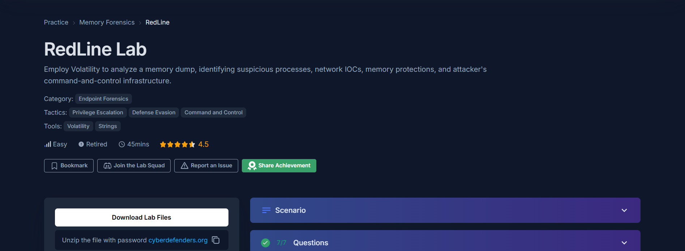

**Scenario**

> *As a member of the Security Blue team, your assignment is to analyze a memory dump using Redline and Volatility tools. Your goal is to trace the steps taken by the attacker on the compromised machine and determine how they managed to bypass the Network Intrusion Detection System (NIDS). Your investigation will identify the specific malware family employed in the attack and its characteristics. Additionally, your task is to identify and mitigate any traces or footprints left by the attacker.*

**Q1: What is the name of the suspicious process?**

After unzip the zip file we got the `MemoryDump.mem` file. Firstly I would try to know the version of the Operating System I am working with 

`python3 vol.py -f MemoryDump.mem windows.info` 

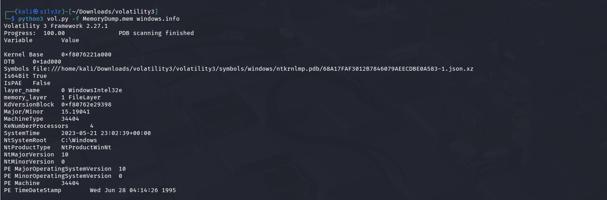

Secondly to list all the processes I will try out the plugin `pstree` to presents a hierarchical view of the processes, showcasing the parent-child relationships. 

And one process that took my eyes was `“oneetx.exe”`

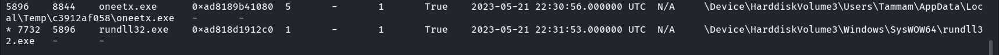

As we can see above the PID is 5896 and PPID is 8844

Then let’s check if it really malicious process ! 

`python3 vol.py -f MemoryDump.mem windows.malware.malfind.Malfind`

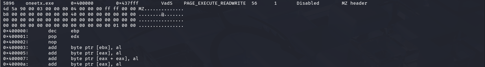

And yeah we were right `“oneetx.exe”` is the malicious process

Answer: `oneetx.exe`

**Q2: What is the child process name of the suspicious process?**

Now let's go back to the original output of the `pstree` to see the process and its descendants

As we know the malicious process is `“oneetex.exe”` and the child process is `“rundll32.exe”`

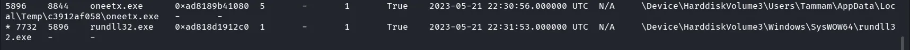

Answer: `rundll32.exe`

**Q3: What is the memory protection applied to the suspicious process memory region?**

We can know the protection methods used in different ways

1. The `malfind` plugin in Volatility is useful for identifying suspicious memory regions

`python3 vol.py -f MemoryDump.mem windows.malware.malfind.Malfind`

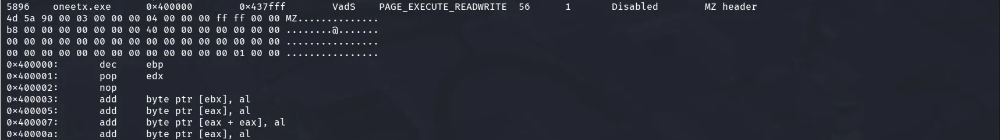

1. You might also want to use the `vadinfo` plugin for detailed memory mappings.

`python3 vol.py -f MemoryDump.mem windows.vadinfo --pid 5896`

> *Note: VAD (Virtual Address Descriptor) info plugin provides details about memory mappings, such as base address, size, protection, and attributes, for each virtual memory region within a process.*

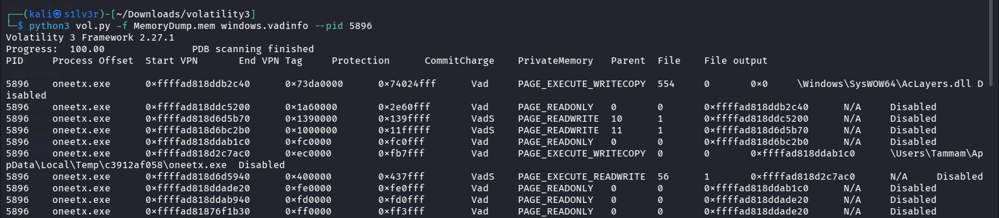

Answer: `PAGE_EXECUTE_READWRITE`

**Q4: What is the name of the process responsible for the VPN connection?**

Well for this I’m use `windows.netscan` to find active network connections. Look for connections established by processes that might be involved in a VPN.

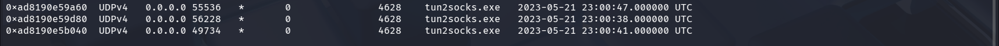

And after inspecting the connections for a while I noticed a specific process that I thought "it might be it” , so let’s make a  search on it. 

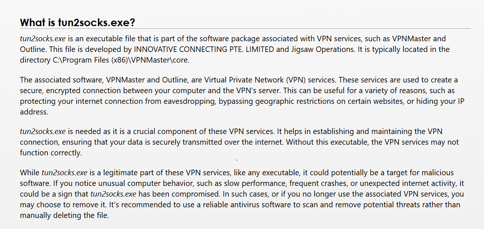

So apparently it is associated with VPN services. So how about we look for it in the `pstree` using it’s PID?

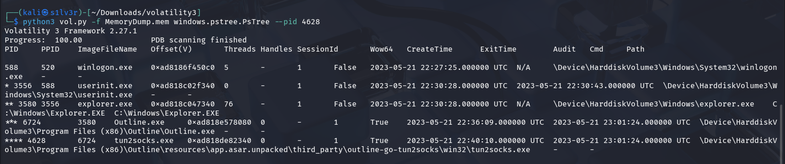

As we can see the `tun2socks.exe` is a child process for `Outline.exe` . So the basic process which is responsible about VPN is  `“Outline.exe”`

Answer: `Outline.exe`

**Q5: What is the attacker's IP address?**

Use the `netscan` plugin to list all network connections. Focus on connections linked to the suspicious process.

`python3 vol.py -f MemoryDump.mem windows.netscan | grep onetx.exe`

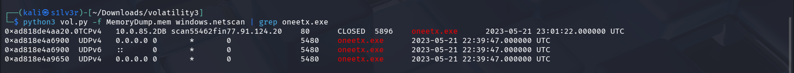

As we can see above the address associated with the process is the following ⇒ 77.91.124.20

Answer: `77.91.124.20`

**Q6: What is the full URL of the PHP file that the attacker visited?**

The idea that came to my mind was that the php visited must belong to the attacker's domain so I searched the strings of the memorydump for entries having the IP of the attacker in them.

`strings MemoryDump.mem | grep 77.91.124.20`

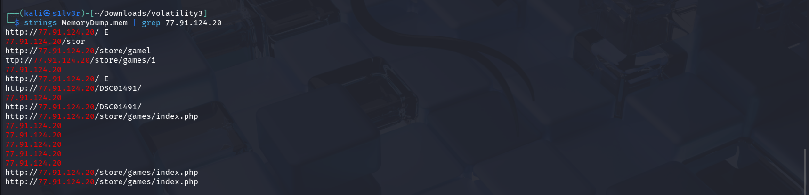

Answer: `http://77.91.124.20/store/games/index.php`

**Q7: What is the full path of the malicious executable?**

To discover the file path, consider examining file-related artifacts within the memory dump. The `filescan` plugin can help you identify file paths in memory. You might also extract the executable directly to see its path.

`python3 vol.py -f MemoryDump.mem windows.filescan | grep onetx.exe`

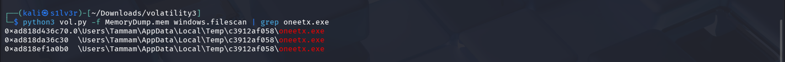

Answer: `C:\Users\Tammam\AppData\Local\Temp\c3912af058\oneetx.exe`

---

## Insider Lab

**Scenario**

> *After Karen started working for 'TAAUSAI,' she began doing illegal activities inside the company. 'TAAUSAI' hired you as a soc analyst to kick off an investigation on this case.*
>
> *You acquired a disk image and found that Karen uses Linux OS on her machine. Analyze the disk image of Karen's computer and answer the provided questions.*

**Q1: Which Linux distribution is being used on this machine?**

Consider where operating system details might be stored within the system directories. Navigate to the `boot` folder in the disk image and inspect the files there

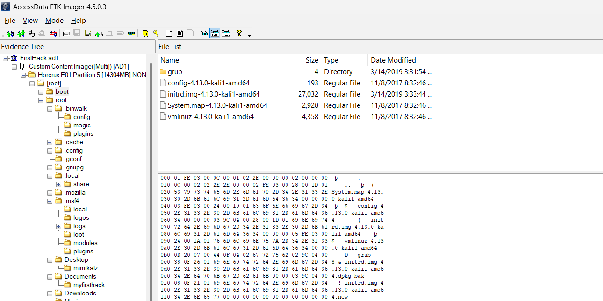

Answer: `kali`

**Q2: What is the MD5 hash of the Apache access.log file?**
Locate the access.log file in `/var/log/apache2/`. You can determine its MD5 hash by right-clicking on the file and viewing its properties.

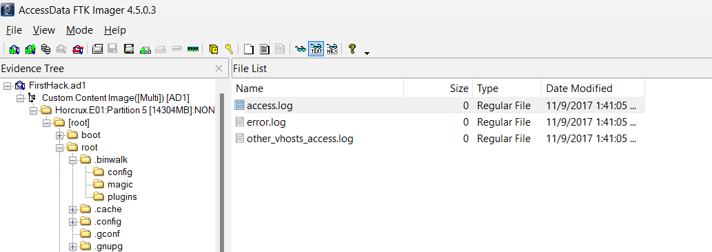

And here

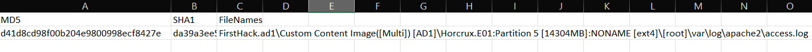

Answer: `d41d8cd98f00b204e9800998ecf8427e`

**Q3: It is suspected that a credential dumping tool was downloaded. What is the name of the downloaded file?**

Downloads are often stored in the user's default download directory.

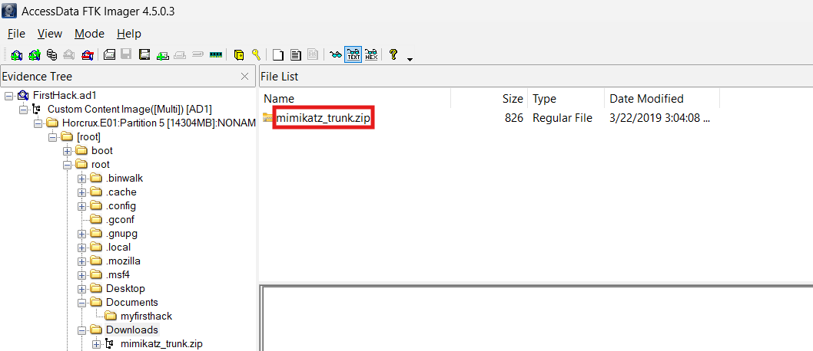

**Q4: A super-secret file was created. What is the absolute path to this file?**

When users create files and directories, their commands are often logged. The `bash_history` file logs all commands executed by the user.

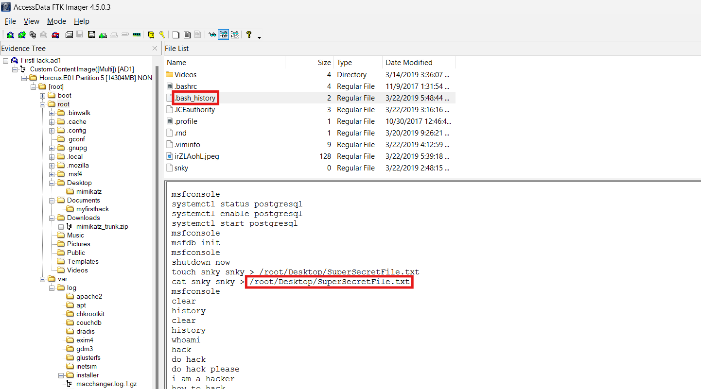

Answer: `/root/Desktop/SuperSecretFile.txt`

**Q5: What program used the file didyouthinkwedmakeiteasy.jpg during its execution?**
Upon reviewing the `bash_history` file, you'll see that the program was used to analyze didyouthinkwedmakeiteasy.jpg

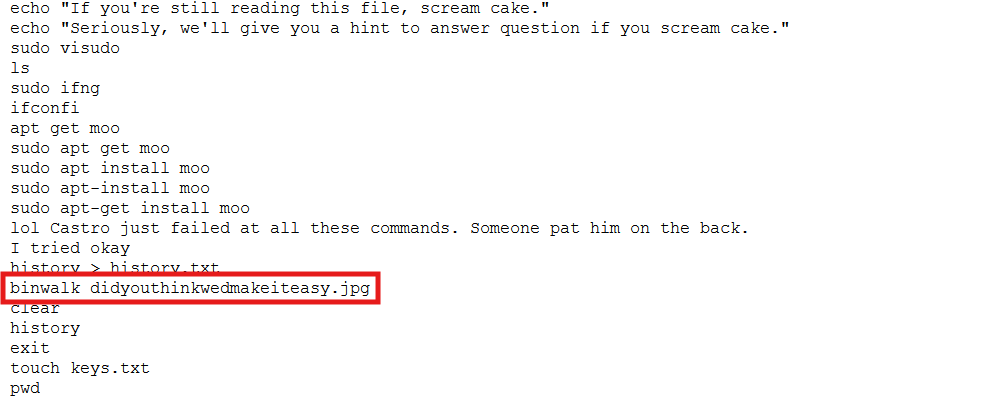

**Q6: What is the third goal from the checklist Karen created?**

Users often store checklists and notes on their desktop. There should be a file named `Checklist` on the desktop. Opening this file will reveal the goals listed by Karen.

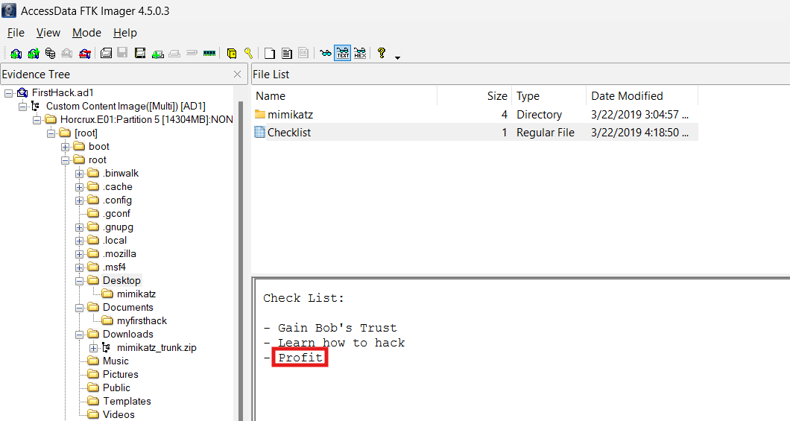

Answer: `Profit`

**Q7: How many times was Apache run?**

The logs in `/var/log/apache2/` all have a size of 0 bytes, indicating that `Apache` was never run on this system.

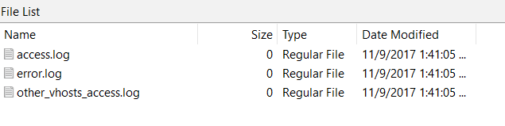

Answer: `0`

**Q8: This machine was used to launch an attack on another. Which file contains the evidence for this?**

The `root` directory might contain files that provide evidence of malicious activities. Look for any suspicious files there.

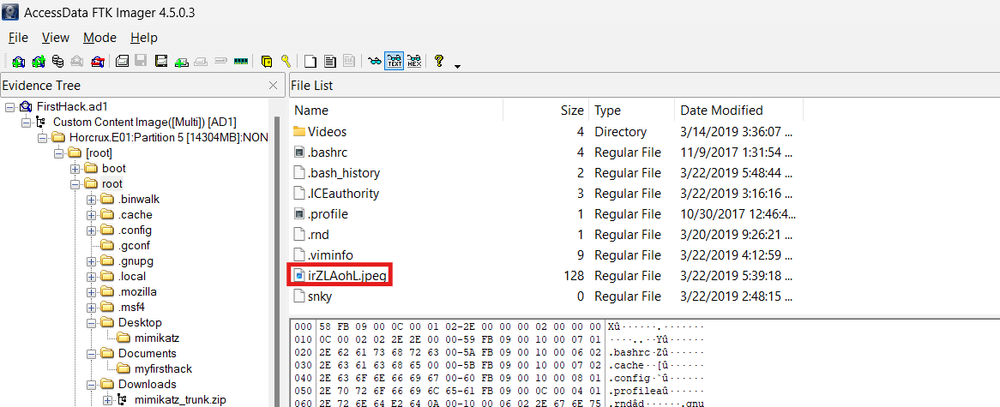

The file is an image found in the `root` directory that shows evidence that this machine was used in an attack. The image shows a command prompt with elevated privileges, likely pointing to an attack scenario.

Answer: `irZLAohL.jpeg`

**Q9: It is believed that Karen was taunting a fellow computer expert through a bash script within the Documents directory. Who was the expert that Karen was taunting?**

Scripts and taunts might be found in the Documents directory. In the `/root/Documents/myfirsthack/` directory, open the `firstscript_fixed` bash script. It mentions the name indicating that Karen was taunting this individual.

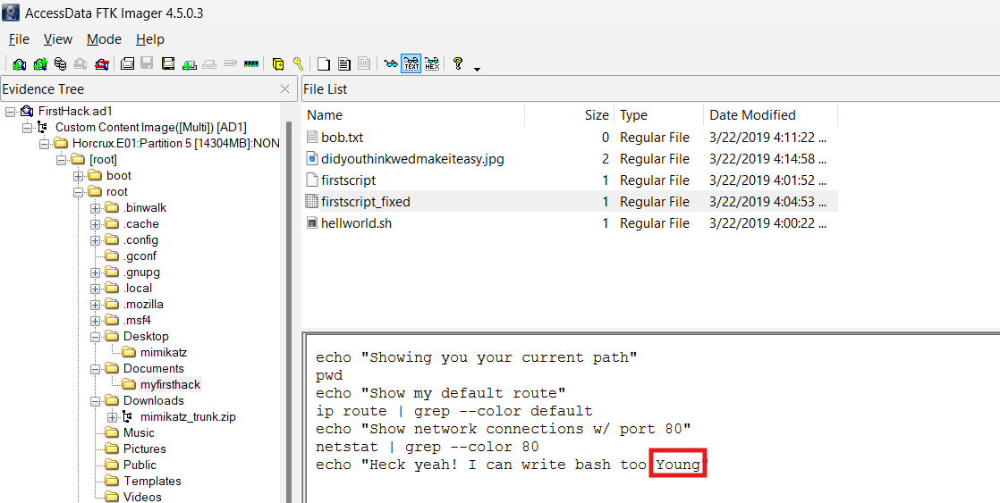

Answer: `Young`

**Q10: A user executed the su command to gain root access multiple times at 11:26. Who was the user?**
To find out who switched to root, you should examine the system's authentication logs. The `auth.log` file contains records of all `su` commands. Look for entries around `11:26` to identify the user who switched to root.

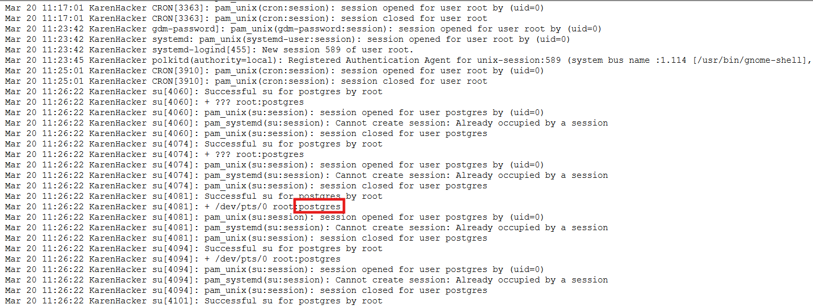

Answer: `postgres`

**Q11: Based on the bash history, what is the current working directory?**

The current working directory can often be determined from the most recent commands. The last few commands like `cd` in the `bash_history` file should reveal the current working directory.

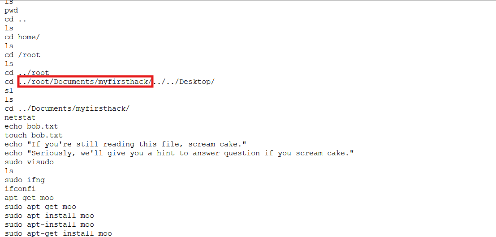

Answer: `/root/Documents/myfirsthack/`

---

## AfricanFalls Lab

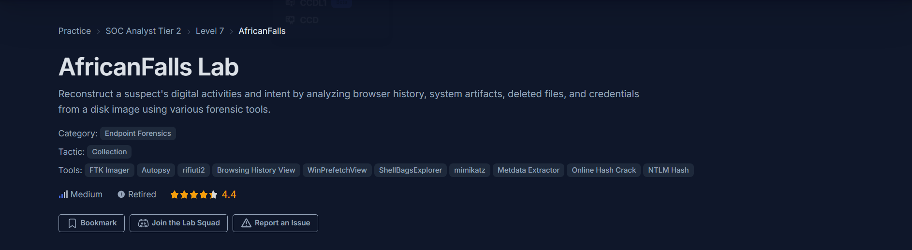

**Scenario**

> *John Doe was accused of doing illegal activities. A disk image of his laptop was taken. Your task as a soc analyst is to analyze the image and understand what happened under the hood.*

**Q1: What is the MD5 hash value of the suspect disk?**

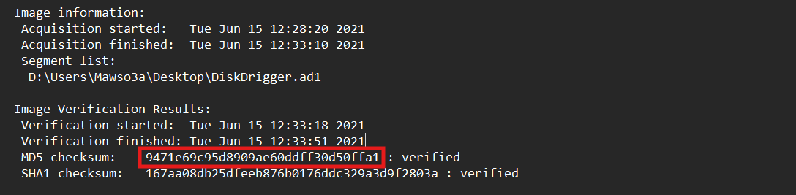

Answer: `9471e69c95d8909ae60ddff30d50ffa1`

**Q2: What phrase did the suspect search for on 2021-04-29 18:17:38 UTC? (three words, two spaces in between)**

Consider looking into the Chrome browsing history around the specified time. Export `History` file located at `C:\Users\John Doe\AppData\Local\Google\Chrome\User Data\Default` and use DB Browser for SQLite.

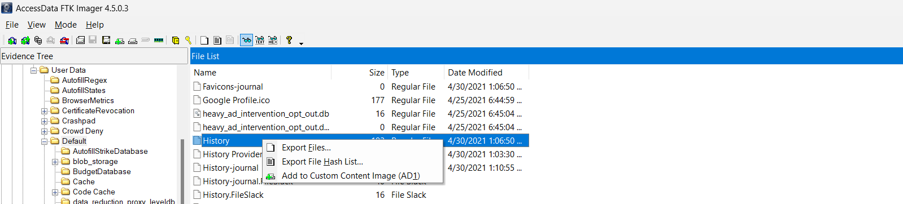

Open DB Brower and open `History` file that you exported

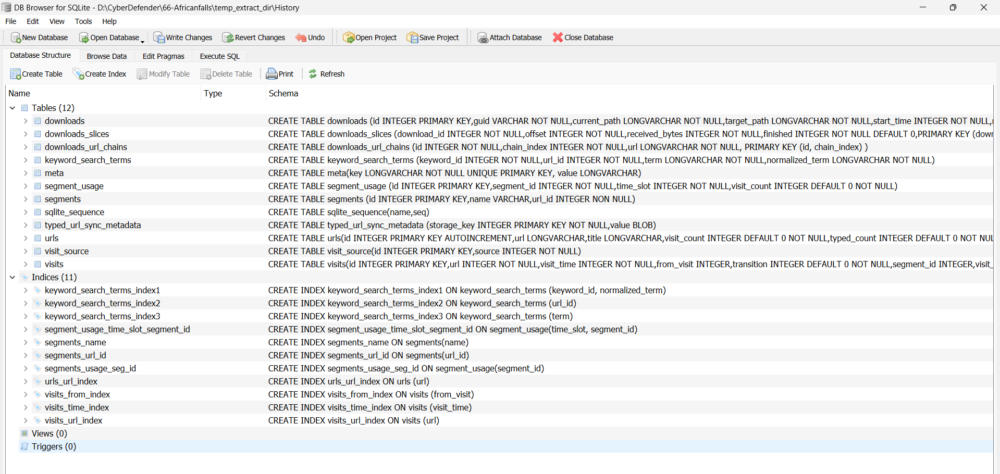

Navigate to the `'URL'` table and search by `last_visit_time`

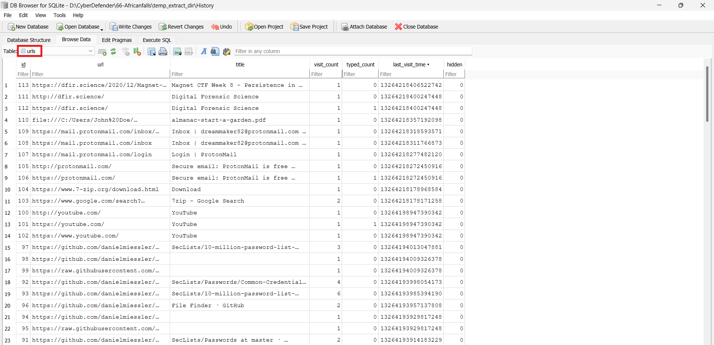

And use `DCode` for Timestamp analysis.

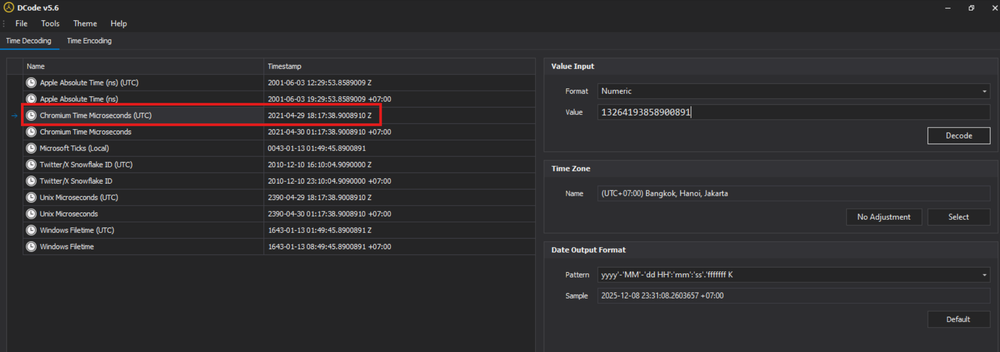

Now I find the Date I search for `2021–04–29 18:17:38 UTC` and go to DB Brower search for it

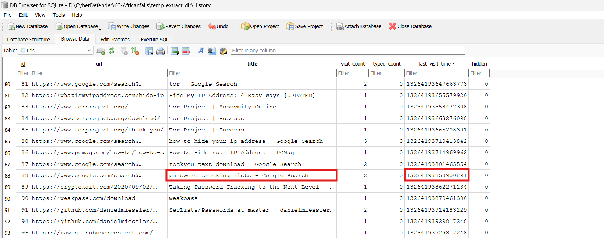

Answer: `password cracking lists`

**Q3: What is the IPv4 address of the FTP server the suspect connected to?**

Check any configuration files related to `FileZilla`, a common FTP client. Navigate to the `FileZilla` directory in the suspect’s `AppData` folder to locate recent FTP connections.

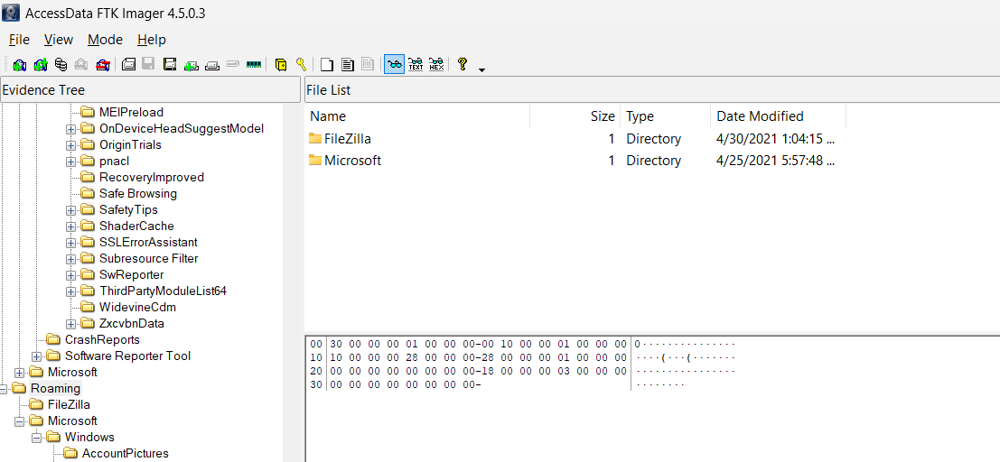

Open the r`ecentservers.xml` file to find the IPv4 address of the FTP server the suspect last connected to.

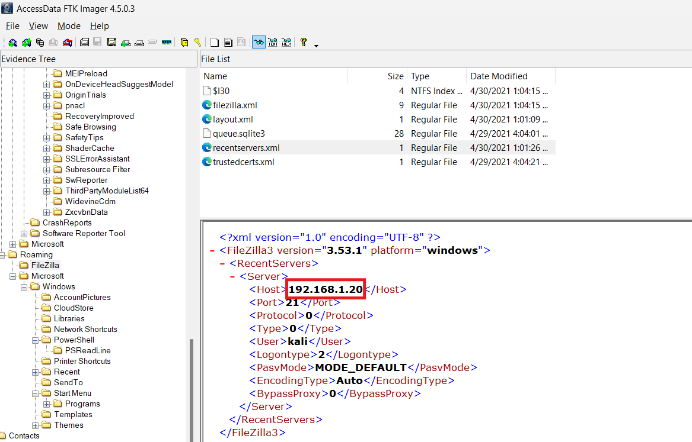

Answer: `192.168.1.20`

**Q4: What date and time was a password list deleted in UTC? (YYYY-MM-DD HH:MM:SS UTC)**

Now we can use `Autospy` to Deep Analysis. Start by examining the `Recycle Bin` for deleted files.

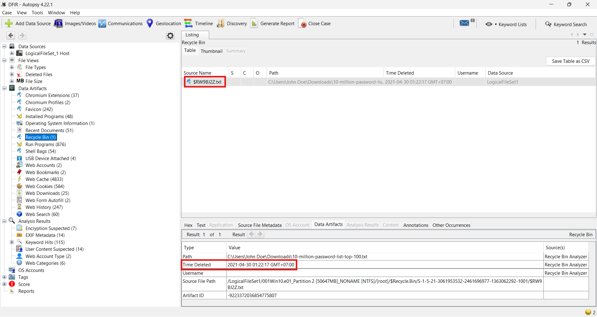

The data and time are `2021-04-30 01:22:17 GMT+07:00` . But the answer in UTC format just go to any Converter from GMT to UTC

Answer: `2021-04-29 18:22`

**Q5: How many times was Tor Browser ran on the suspect's computer? (number only)**

Analyze the list of run programs from the system. Look for entries specific to `Tor Browser`.

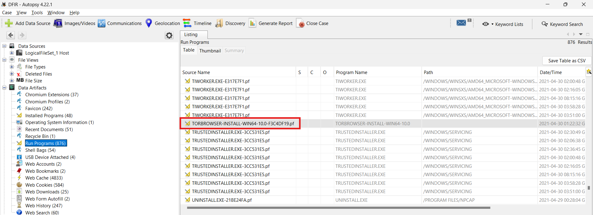

There is only a prefetch file for the Setup & Install. There is no Prefetch file for executing the `Tor Browser` .

Answer: `0`

**Q6: What is the suspect's email address?**

We will search in `Web History` again and save its  to CSV for easy searching.

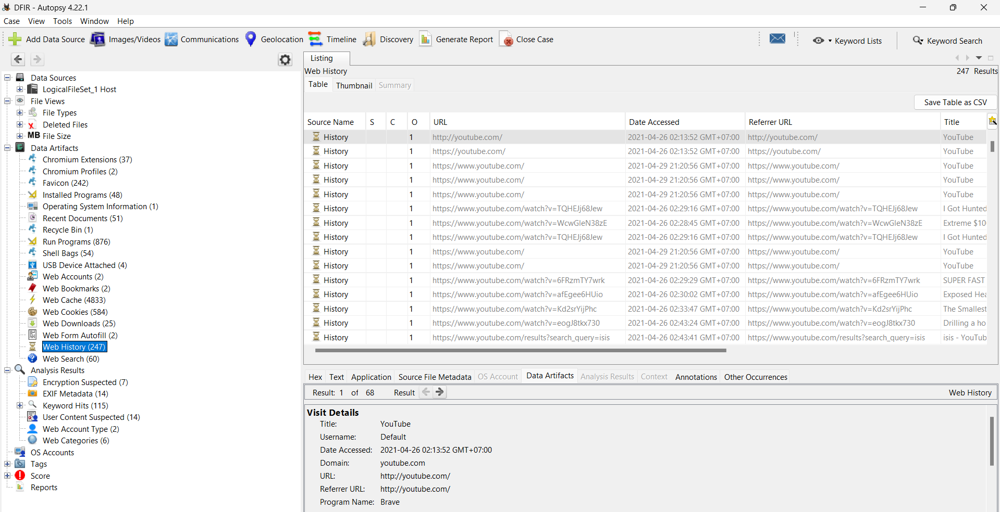

As any email format `@gmail.com` . So we can search by (@) as a common factor in any email.

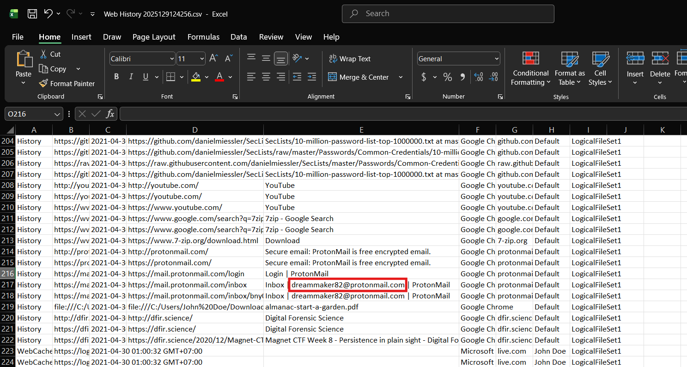

Answer: `dreammaker82@protonmail.com`

**Q7: What is the FQDN did the suspect port scan?**

Check the command history files for any network scanning activities. Look into PowerShell’s command history for any entries related to network scanning tools like `nmap`.

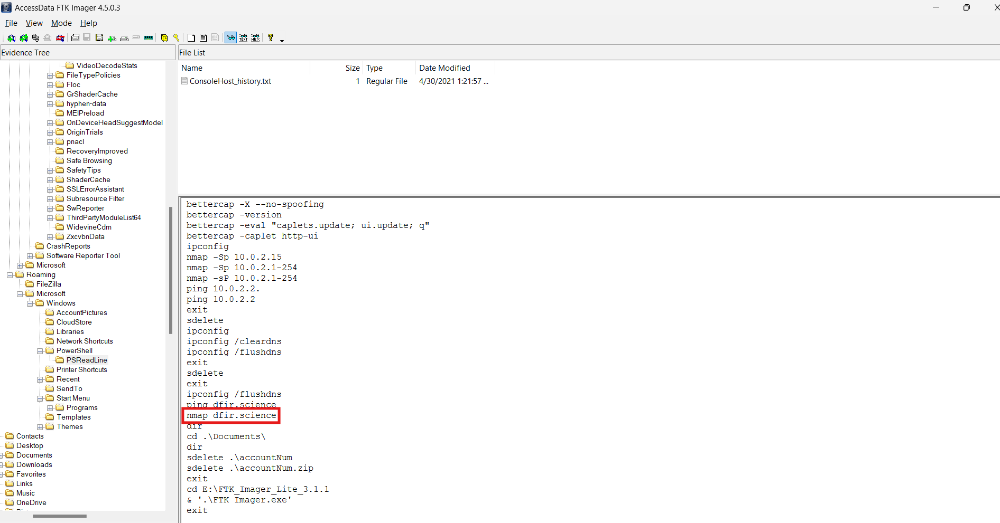

Open the file `ConsoleHost_history.txt` located in `C:\Users\John Doe\AppData\Roaming\Microsoft\Windows\PowerShell\PSReadLine\` and search for FQDNs associated with network scans.
Answer: `dfir.science`
**Q8: What country was picture "20210429_152043.jpg" allegedly taken in?**

First way:

We can use `Geolocation` from Autopsy

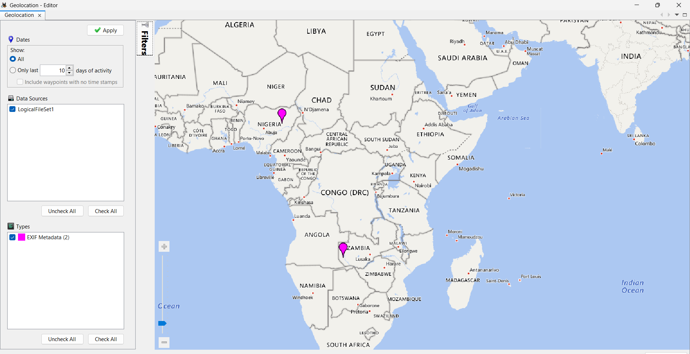

You will found 2 Locations on it one in `NIGERIA` and the second in `ZAMBIA`

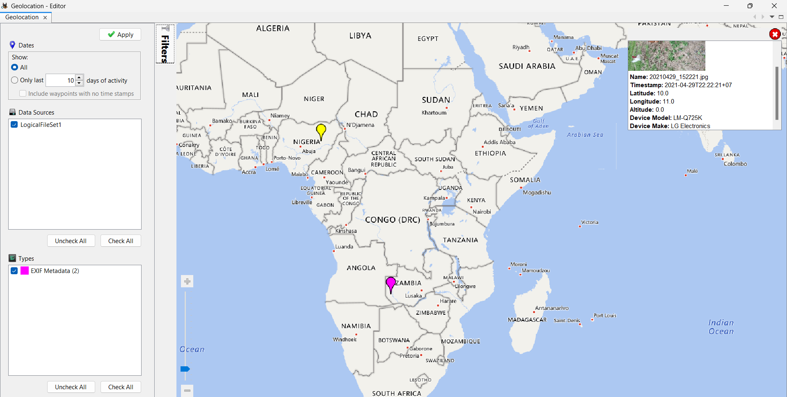

The photo that in `NIGERIA`  not match to `20210429_152043.jpg` . So I will try `ZAMBIA` and I found the `20210429_152043.jpg`

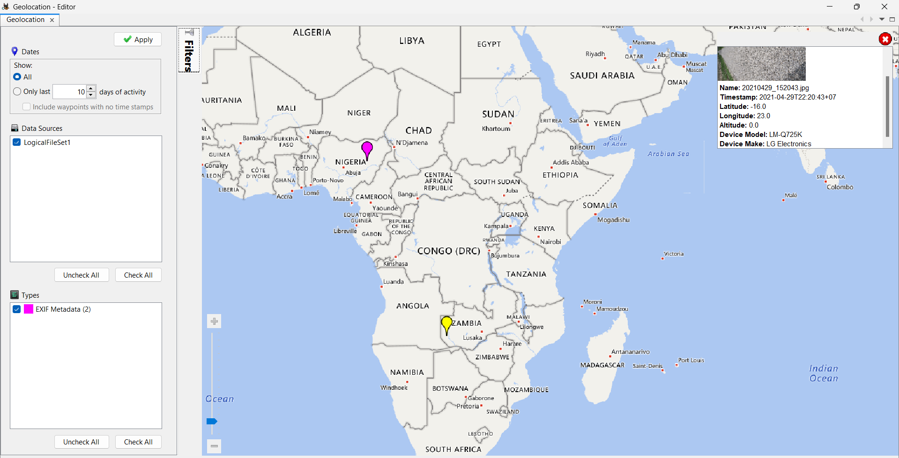

Second way:

You search for pictures file I found in `Users/John Doe/Pictures/Contact`  (`20210429_152043.jpg`) and export it.

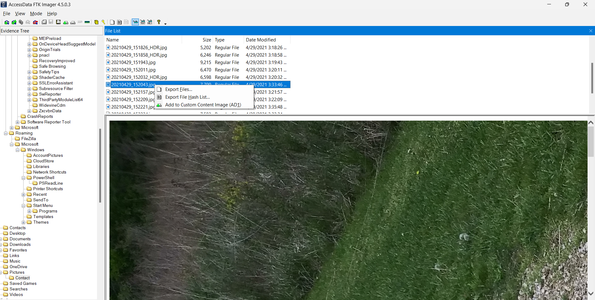

After exporting it use `exiftool` and we will found GPS

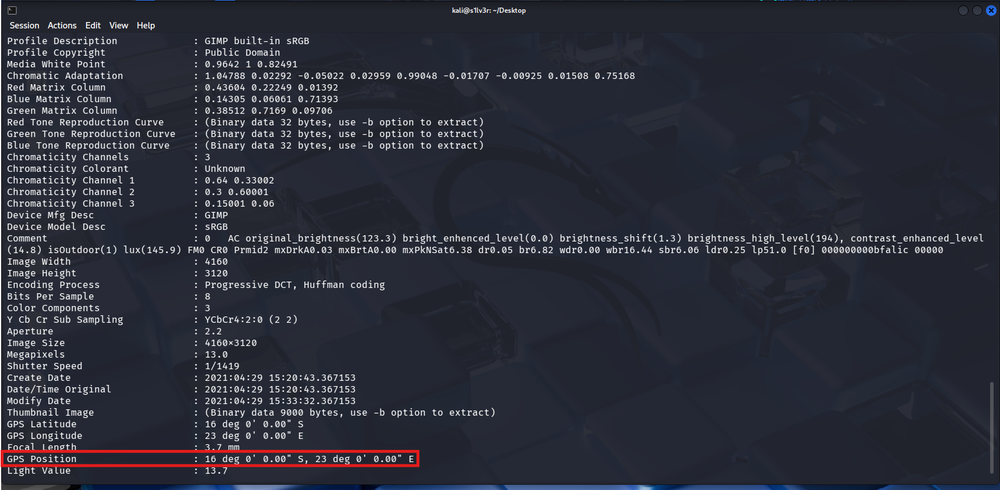

Search by Latitude as 16:0:0 and Longitude as 23:0:0:0 ⇒ Zambia

Answer: `Zambia`

**Q9: A Windows password hashes for an account are below. What is the user's password? Anon:1001:aad3b435b51404eeaad3b435b51404ee:3DE1A36F6DDB8E036DFD75E8E20C4AF4**

Recognize the format of the provided password hashes, which typically consist of the LM hash and the NTLM hash of the user’s password.

The Hash of Password is: `3DE1A36F6DDB8E036DFD75E8E20C4AF4`

Utilize password-cracking tools such as hashcat, John the Ripper, or online hash-cracking services to attempt to crack the NTLM hash and retrieve the original password.

Input the NTLM hash into an online hash-cracking service like [onlinehashcrack.com](http://onlinehashcrack.com/) , [hashes.com](http://hashes.com/)

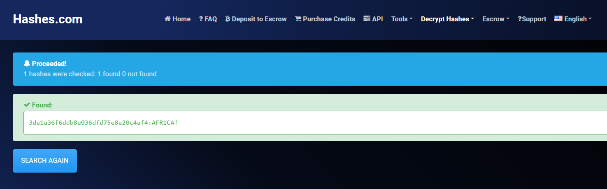

Once the hash-cracking process is complete, interpret the result to obtain the user’s password. In this case, the password was determined to be `“**AFR1CA!**”`.
Answer: **`AFR1CA!`**
**Q10: What is the user "John Doe's" Windows login password?**

Extract `SAM` and `SYSTEM` hives using FTK imager

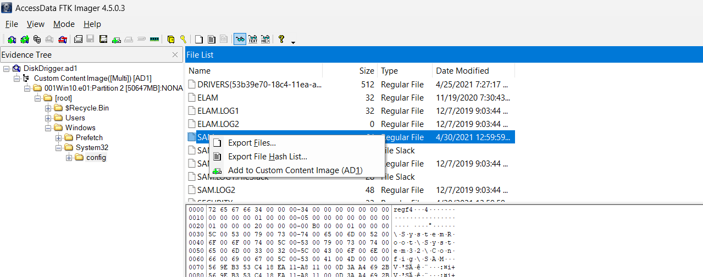

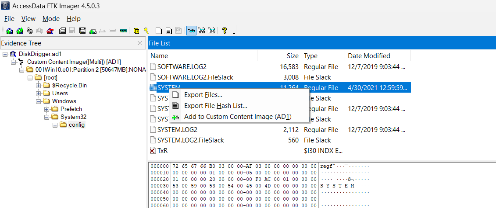

Then used `impacket`  to dump the password hashes of the Users using the command `“ impacket-secretsdump -sam SAM -system SYSTEM LOCAL”`

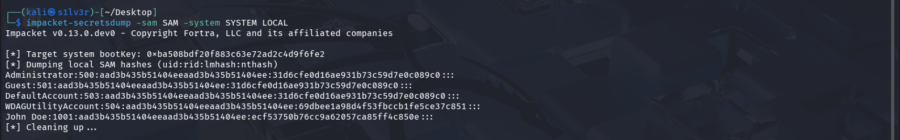

The hash of password is: `ecf53750b76cc9a62057ca85ff4c850e`

Used John to brute force the hash

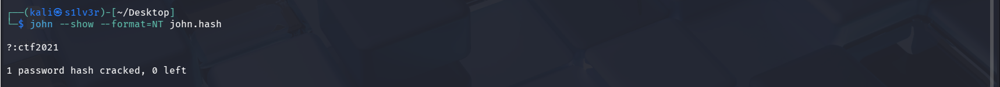

Answer: `ctf2021`

---

## Ramnit Lab

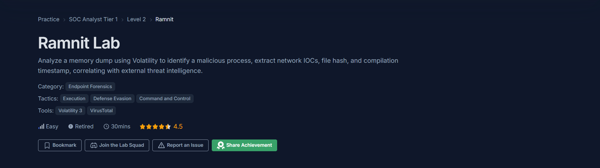

**Scenario**

> Our intrusion detection system has alerted us to suspicious behavior on a workstation, pointing to a likely malware intrusion. A memory dump of this system has been taken for analysis. Your task is to analyze this dump, trace the malware’s actions, and report key findings.

**Q1: What is the name of the process responsible for the suspicious activity?**

Use Volatility's `pstree` plugin to view the process hierarchy and identify any names that don’t typically belong to legitimate Windows operations, as these may indicate malware.

`python vol.py -f memory.dmp  windows.pstree`

Then dumped the process `--pid 4628` and uploaded the binary hash to VirusTotal

`python vol.py -f memory.dmp  windows.dumpfiles --pid 4628`

Which returned a 100% malicious

Answer: `ChromeSetup.exe`

**Q2: What is the exact path of the executable for the malicious process?**

To locate the executable file’s path, try scanning for file objects related to the suspicious process. Use the `filescan` plugin in Volatility to search for file paths associated with `"ChromeSetup"`.

Answer: `C:\Users\alex\Downloads\ChromeSetup.exe`

**Q3: Identifying network connections is crucial for understanding the malware's communication strategy. What IP address did the malware attempt to connect to?**

Examine network-related artifacts in the memory dump to find the destination IPs of active or recent connections. Use the `netscan` plugin to list network connections and search for connections involving the suspicious process

Answer: `58.64.204.181`

**Q4: To determine the specific geographical origin of the attack, Which city is associated with the IP address the malware communicated with?**

Use an IP lookup tool to locate the city associated with the IP address discovered in the previous question. Try an IP geolocation service to find details about the IP. 

[Free IP Geolocation API and Accurate IP Geolocation Database](https://ipgeolocation.io/)

Answer: `HongKong`

**Q5: Hashes serve as unique identifiers for files, assisting in the detection of similar threats across different machines. What is the SHA1 hash of the malware executable?**

Answer: `280c9d36039f9432433893dee6126d72b9112ad2`

**Q6: Examining the malware's development timeline can provide insights into its deployment. What is the compilation timestamp for the malware?**

Check History (Creation Time) in Detail 

Answer: `2019-12-01 08:36`

---

## BlackEnergy Lab

**Scenario**

> A multinational corporation has suffered a cyber attack, resulting in the theft of sensitive data. The attack employed a previously unseen variant of the BlackEnergy v2 malware. The company's security team has obtained a memory dump from the infected machine and is seeking your expertise as a SOC analyst to analyze the dump in order to understand the scope and impact of the attack.

**Q1: Which volatility profile would be best for this machine?**

Run the `imageinfo` command on the memory dump file. Focus on the Suggested Profile(s) field in the output.

`python2 vol.py -f CYBERDEF-567078-20230213-171333.raw imageinfo`

Answer: `WinXPSP2x86`

**Q2: How many processes were running when the image was acquired?**

Use the `pslist` plugin after determining the correct profile. Count the number of processes listed.

`python2 vol.py -f CYBERDEF-567078-20230213-171333.raw --profile=WinXPSP2x86 pslist`

I counted processes that had no valid exit time (exit timestamp 0000-00-00 00:00:00 UTC+0000), which indicates they were running when the image was captured. From the total process list (25), excluding 6 processes with non-empty exit times leaves (19) active processes at acquisition.

Answer: `19`

**Q3: What is the process ID of cmd.exe?**
Using the output from the `pslist` command, search for the `cmd.exe` process. Its process ID (PID) will be in the first column.

Answer: `1960`

**Q4: What is the name of the most suspicious process?**

`rootkit.exe` immediately stands out as suspicious due to its name, since legitimate Windows processes do not use such naming conventions.

Answer: `rootkit.exe`

 **Q5: Which process shows the highest likelihood of code injection?**

Run the `malfind` plugin to look for suspicious memory sections that may indicate code injection.

`python2 vol.py -f CYBERDEF-567078-20230213-171333.raw --profile=WinXPSP2x86 malfind`

`malfind` flagged PID **880** as the strongest injection candidate. The memory region contains an `MZ` header (`4D 5A`), indicating a PE image was present in memory where it normally should not be a classic sign of code injection into `svchost.exe`.

Answer: `svchost.exe`

**Q6: There is an odd file referenced in the recent process. Provide the full path of that file.**

Run the `handles` plugin to identify file paths referenced by the process from question 5. Using `handles -p 880 -t file` to enumerate open handles for the suspicious `svchost` process, a file handle referenced `\Device\HarddiskVolume1\WINDOWS\system32\drivers\str.sys`. Mapped to the filesystem, that corresponds to **`C:\WINDOWS\system32\drivers\str.sys`**, a driver-file location that looks anomalous given the filename and context.

`python2 vol.py -f CYBERDEF-567078-20230213-171333.raw --profile=WinXPSP2x86 handles -p 880 -t file`

Answer: `C:\WINDOWS\system32\drivers\str.sys`

**Q7: What is the name of the injected DLL file loaded from the recent process?**

The `ldrmodules` plugin in Volatility can help list DLLs loaded by a process. Look for any suspicious ones. Focus on DLLs that are marked as not fully loaded or seem unusual in name or path.

`python2 vol.py -f CYBERDEF-567078-20230213-171333.raw --profile=WinXPSP2x86 -p 880 ldrmodules` 

Answer: `msxml3r.dll`
**Q8: What is the base address of the injected DLL?**

The base address of the injected DLL should be visible in the `malfind` output, near memory regions flagged for suspicious activity

`python2 vol.py -f CYBERDEF-567078-20230213-171333.raw --profile=WinXPSP2x86 malfind`

Answer: `0x980000`

---

## Sysinternals Lab

**Scenario**

> A user thought they were downloading the SysInternals tool suite and attempted to open it, but the tools did not launch and became inaccessible. Since then, the user has observed that their system has gradually slowed down and become less responsive.

**Q1: What was the malicious executable file name that the user downloaded?**

Start by examining the user's download history and focus on the Downloads folder. Look for any executable files that seem unusual.

Check the Public directory within the User folder on the device. Identify any executable files that do not belong or look suspicious.

Answer: `SysInternals.exe`

**Q2: When was the last time the malicious executable file was modified?**

Look into the file metadata to determine when it was last modified. The `SYSTEM` registry hive may contain this information.

Extract the `SYSTEM` registry hive and analyze it using the `AppCompatCacheParser` tool to find the modification date for `Sysinternals.exe.`

After parsing the `SYSTEM` registry hive with `AppCompatCacheParser`, locate `sysinternals` in the output.

Answer: `2022-11-15 21:18`

**Q3: What is the SHA1 hash value of the malware?**

The SHA1 hash of the file may be recorded in the `Amcache.hve` registry hive, which tracks executed files.

Extract the `Amcache.hve` file from the image and use the `AmcacheParser` tool to begin searching for the hash of `Sysinternals.exe.`

Parse the `Amcache.hve` file with `AmcacheParser` and search through the output to locate the SHA1 hash of `Sysinternals.exe.` 

Answer: `fa1002b02fc5551e075ec44bb4ff9cc13d563dcf`

**Q4: Based on the Alibaba vendor, what is the malware's family?**

To determine the malware family, you can submit its hash to a public malware analysis platform like VirusTotal.

After submitting the `SHA1` hash of `Sysinternals.exe` to VirusTotal, explore the `Details` tab to identify the malware's family.

Answer: `Rozena`

**Q5: What is the first mapped domain's Fully Qualified Domain Name (FQDN)?**

After analyzing the malware's SHA1 hash on VirusTotal, navigate to the `Relations` tab to see associated domains.

In the `'Relations'` tab of VirusTotal, identify the first suspicious domain linked to `Sysinternals.exe` to find the Fully Qualified Domain Name (FQDN).

The PSReadLine directory contains several files, including `PSReadLine ConsoleHost_history.txt.` A file that stores the command history for the PowerShell console. Let’s check it out:

Answer: `www.malware430.com`

**Q6: The mapped domain is linked to an IP address. What is that IP address?**

The IP address linked to the domain might be recorded in PowerShell command history or in the system's hosts file.

Examine PowerShell history or the Windows hosts file using Autopsy to identify any IP address associated with the malicious domain.

Answer: `192.168.15.10`

**Q7: What is the name of the executable dropped by the first-stage executable?**

In VirusTotal, check the `Behavior` tab and observe the `Process Tree` to track the executables spawned by `Sysinternals.exe.`

Answer: `vmtoolsIO.exe`

**Q8: What is the name of the service installed by 2nd-stage executable?**

That command sequence shows `vmtoolsIO.exe` calling its installer mode and then using `net start` / `sc config` to register `VMwareIOHelperService` to start automatically. The service name appears in the service-creation entries in the dynamic-analysis report and is corroborated by service-related artifacts on the image.

Answer: `VMwareIOHelperService`

---

## Reveal Lab

**Scenario**

> You are a forensic investigator at a financial institution, and your SIEM flagged unusual activity on a workstation with access to sensitive financial data. Suspecting a breach, you received a memory dump from the compromised machine. Your task is to analyze the memory for signs of compromise, trace the anomaly's origin, and assess its scope to contain the incident effectively.

**Q1: Identifying the name of the malicious process helps in understanding the nature of the attack. What is the name of the malicious process?**

First we determine if this memory dump was taken from Windows or Linux

`python vol.py -f "D:\CyberDefender\192-Reveal\temp_extract_dir\192-Reveal.dmp" windows.info`

Begin by examining the processes in the memory dump. Utilize the `malfind` plugin in Volatility to detect processes and identify those that seem out of place or show suspicious behavior.

`python vol.py -f "D:\CyberDefender\192-Reveal\temp_extract_dir\192-Reveal.dmp" windows.malware.malfind.Malfind`

Answer: `powershell.exe`

**Q2: Knowing the parent process ID (PPID) of the malicious process aids in tracing the process hierarchy and understanding the attack flow. What is the parent PID of the malicious process?**

Determining the parent process of a suspicious process can provide insight into how it was initiated. Use the `pstree` plugin in Volatility to correlate with the suspicious process identified in the previous question. This will help you view the hierarchical relationships between processes.

`python vol.py -f "D:\CyberDefender\192-Reveal\temp_extract_dir\192-Reveal.dmp" windows.pstree.PsTree`

Answer: `4120`

**Q3: Determining the file name used by the malware for executing the second-stage payload is crucial for identifying subsequent malicious activities. What is the file name that the malware uses to execute the second-stage payload?**

The file name of the second-stage payload may be found in the command-line arguments of the suspicious process. Use the `cmdline` command in Volatility with the suspicious process ID identified earlier to reveal command-line arguments.

`python vol.py -f "D:\CyberDefender\192-Reveal\temp_extract_dir\192-Reveal.dmp" windows.cmdline.CmdLine`

Answer: `3435.dll`

**Q4: Identifying the shared directory on the remote server helps trace the resources targeted by the attacker. What is the name of the shared directory being accessed on the remote server?** 

 The shared directory name might be found in network-related strings within the memory. Use `strings` in conjunction with `grep` to search for the attacker’s IP address within the memory dump, which may reveal paths or shared directories.

`strings 192-Reveal.dmp| grep 45.9.74.32`

Answer: `davwwwroot`

**Q5: What is the MITRE ATT&CK sub-technique ID that describes the execution of a second-stage payload using a Windows utility to run the malicious file?**

Search with executing malicious `dll` using `rundll32` Mitre technique 

Answer: `T1218.011`

**Q6: Identifying the username under which the malicious process runs helps in assessing the compromised account and its potential impact. What is the username that the malicious process runs under?**

Consider how the `getsids` plugin can help analyze process data and extract user-related information from the memory dump, focus on the process with PID `3692`, uncovering its associated SIDs, user accounts, and privileges.

`python vol.py -f "D:\CyberDefender\192-Reveal\temp_extract_dir\192-Reveal.dmp" windows.getsids.GetSids`

Or we can use `sessions` plugin

`python vol.py -f "D:\CyberDefender\192-Reveal\temp_extract_dir\192-Reveal.dmp" windows.sessions.Sessions`

Answer: `Elon`

**Q7: Knowing the name of the malware family is essential for correlating the attack with known threats and developing appropriate defenses. What is the name of the malware family?**

Connecting IP addresses or file hashes from the memory dump to known databases can help identify the malware family. Consider cross-referencing any suspicious IP addresses with open-source threat intelligence platforms, like VirusTotal, to gather additional information.

Answer: `StrelaStealer`
